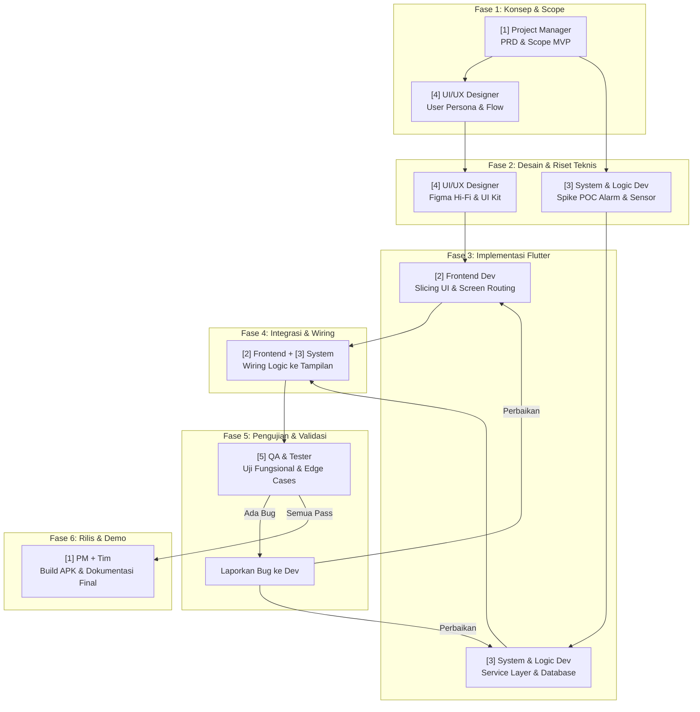

# Panduan Kolaborasi Tim & Alur Kerja Proyek BangunYuk

Dokumen ini adalah peta besar (*master workflow*) koordinasi tim pengembang **BangunYuk**. Panduan ini mengatur bagaimana 5 anggota tim saling berinteraksi, alur transfer berkas/pekerjaan (*handoff*), jadwal fase, dan tata kelola repository.

---

## 🗺️ Peta Alur Kerja Antar-Peran (End-to-End Workflow)

---

## 👥 Indeks Panduan Mandiri Per Anggota

Setiap anggota memiliki panduan kerja mandiri langkah-demi-langkah yang dapat dibaca dan dieksekusi secara terpisah:

| No | Anggota | Jabatan | Tautan Berkas Panduan Pribadi |
| :---: | :--- | :--- | :--- |
| **1** | Anggota 1 | **Project Manager** | [01_Project_Manager.md](file:///C:/Users/Lenovo/.gemini/antigravity/scratch/bangunyuk/panduan_peran/01_Project_Manager.md) |
| **2** | Anggota 2 | **Frontend Developer** | [02_Frontend_Developer.md](file:///C:/Users/Lenovo/.gemini/antigravity/scratch/bangunyuk/panduan_peran/02_Frontend_Developer.md) |
| **3** | Anggota 3 | **System & Logic Developer** | [03_System_Logic_Developer.md](file:///C:/Users/Lenovo/.gemini/antigravity/scratch/bangunyuk/panduan_peran/03_System_Logic_Developer.md) |
| **4** | Anggota 4 | **UI/UX Designer** | [04_UI_UX_Designer.md](file:///C:/Users/Lenovo/.gemini/antigravity/scratch/bangunyuk/panduan_peran/04_UI_UX_Designer.md) |
| **5** | Anggota 5 | **QA & User Testing** | [05_QA_User_Testing.md](file:///C:/Users/Lenovo/.gemini/antigravity/scratch/bangunyuk/panduan_peran/05_QA_User_Testing.md) |

---

## 🔄 Titik Handoff (Serah Terima Pekerjaan Antar-Anggota)

1. **Handoff Desain (`UI/UX` $\rightarrow$ `Frontend`)**:
   - UI/UX menyiapkan link Figma dengan hak akses *View/Inspect*.
   - Menyertakan *Design Tokens* (kode warna hex, ukuran font, jarak padding, icon SVG/PNG).
   - Frontend tidak boleh mulai menebak ukuran UI tanpa konfirmasi dari Figma.

2. **Handoff Logika & Data (`System & Logic` $\rightarrow$ `Frontend`)**:
   - System Developer menyediakan kontrak model (`Alarm`, `TaskItem`) dan method service yang jelas (misal: `AlarmService.schedule(alarm)`).
   - Frontend tinggal memanggil method tersebut saat tombol "Simpan" atau aksi tugas dijalankan.

3. **Handoff Pengujian (`Developer` $\rightarrow$ `QA`)**:
   - Developer menghasilkan file APK rilis (`app-release.apk`) atau debug build yang stabil.
   - Menyertakan catatan rilis singkat (*Release Notes*: fitur apa saja yang sudah bisa diuji dan apa yang belum).

4. **Handoff Pelaporan Bug (`QA` $\rightarrow$ `Developer`)**:
   - QA melaporkan bug menggunakan format baku: **Judul**, **Langkah Reproduksi (Steps to Reproduce)**, **Hasil yang Diharapkan**, **Hasil Nyata**, serta **Tipe HP & Versi Android**.

---

## 🌳 Standar Kolaborasi Git & Repository

- **Branch Utama**:
  - `main`: Kode stabil siap rilis/demo.
  - `develop`: Cabang utama integrasi fitur harian.
- **Branch Fitur (Dibuat per task)**:
  - `feat/ui-home-screen` (Frontend)
  - `feat/alarm-background-service` (System & Logic)
  - `test/matrix-validation` (QA)
- **Aturan Penggabungan (Merge Rule)**:
  - Setiap Pull Request (PR) ke `develop` wajib di-review minimal oleh 1 developer lain dan disetujui PM.

