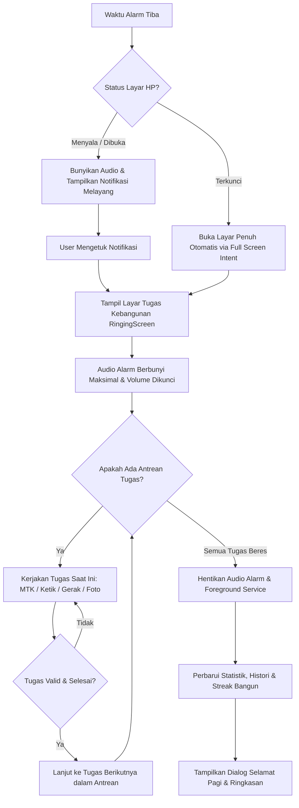

# Product Requirement Document (PRD)
## BangunYuk — Smart Habit-Breaking Alarm Application

| Metadata | Keterangan |
| :--- | :--- |
| **Nama Produk** | **BangunYuk** |
| **Versi Dokumen** | 1.0.0 (Tahap Perancangan Awal) |
| **Status** | *Approved & Active Planning* |
| **Platform Target** | Android (Utama, SDK Min 26 / Android 8.0+, Target SDK 34–36), iOS (Sekunder / Parsial) |
| **Tech Stack Utama** | Flutter, Dart, Foreground Service Native (`package:alarm`), SharedPreferences |
| **Kategori** | Productivity / Health & Lifestyle Tools |

---

## 👥 Tim Pengembang & Peran

| No | Anggota / Jabatan | Tanggung Jawab Utama |
| :---: | :--- | :--- |
| **1** | **Project Manager** | Manajemen proyek, dokumentasi, koordinasi tim, pengawalan timeline & scope |
| **2** | **Frontend Developer** | Implementasi antarmuka, navigasi screen, dan komponen interaktif Flutter |
| **3** | **System & Logic Developer** | Alarm background native, database lokal, logika sensor & fitur anti-cheat |
| **4** | **UI/UX Designer** | Perancangan User Flow, Wireframe, Design System & Prototyping di Figma |
| **5** | **QA & User Testing** | Pengujian fungsionalitas, edge cases, skenario anti-bypass, dan laporan bug |

---

## 1. Executive Summary & Latar Belakang

### 1.1 Problem Statement
Banyak individu mengalami fenomena *sleep inertia* berat—keadaan di mana seseorang mematikan alarm secara setengah sadar (*autopilot*) lalu kembali tidur pulas tanpa menyadarinya. Alarm konvensional bawaan ponsel sangat mudah dihentikan hanya dengan satu ketukan tombol atau mengecilkan tombol volume suara.

### 1.2 Value Proposition
**BangunYuk** adalah aplikasi alarm berintegritas tinggi (*anti-cheat alarm*) yang mewajibkan pengguna menyelesaikan **tugas kebangunan (*wake-up tasks*) fisik dan kognitif** sebelum alarm dapat dimatikan. Dilengkapi proteksi native di level sistem operasi (volume lock, wake lock, foreground service, dan persistent scheduling), BangunYuk memastikan pengguna benar-benar bangun dari tempat tidur dan otaknya terstimulasi.

### 1.3 Target Persona
- **Mahasiswa & Pekerja Komuter**: Orang dengan jadwal pagi ketat yang rawan terlambat karena mematikan alarm tanpa sadar.
- **Heavy Sleepers**: Individu yang kebal terhadap suara alarm biasa dan terbiasa menekan tombol snooze berulang kali.
- **Pembentuk Kebiasaan Pagi (Morning Routine Builders)**: Pengguna yang ingin membangun disiplin bangun subuh/pagi secara konsisten.

---

## 2. Tujuan & Indikator Keberhasilan (OKRs & KPIs)

| Metrik | Target Awal (MVP) | Definisi Keberhasilan |
| :--- | :--- | :--- |
| **Alarm Reliability Rate** | ≥ 99.8% | Alarm berbunyi tepat waktu tanpa gagal terpicu oleh Doze Mode / sistem OEM. |
| **Task Completion Rate** | ≥ 85% | Persentase alarm yang berakhir sukses via penyelesaian misi tugas (bukan *force restart*). |
| **Wake-up Streak Retention** | ≥ 40% D7 retention | Pengguna mempertahankan rentetan bangun pagi minimal 7 hari berturut-turut. |
| **Crash-Free Sessions** | ≥ 99.5% | Tingkat stabilitas aplikasi bebas crash saat memicu layar penuh dari kondisi terkunci. |

---

## 3. Cakupan Produk (Scope of Work)

### 3.1 In-Scope (MVP / Versi 1.0)
- Sistem penjadwalan alarm lokal native (sekali, harian, hari kerja, kustom).
- Foreground service & alarm trigger saat layar terkunci (*Full Screen Intent*) atau aplikasi di-swipe.
- Mekanisme penguncian volume suara (volume override ke 100%).
- Rangkaian 6 tugas kebangunan dasar:
  1. Kognitif: Matematika adaptif (3 soal berturut-turut).
  2. Kognitif/Motorik: Ketik ulang frasa motivasi.
  3. Fisik: Goyang ponsel (akselerometer 20x).
  4. Fisik: Lompat di tempat (deteksi akselerasi *free-fall + impact* 15x).
  5. Penglihatan: Foto benda sekitar (verifikasi tangkapan kamera).
  6. Penglihatan: Foto selfie wajah (kamera depan).
- Kemampuan *multi-task sequencing* (wajib menyelesaikan beberapa tugas berurutan).
- Pembatasan snooze (0 hingga 3 kali maksimal).
- Pelacak statistik lokal (streak hari, riwayat bangun, grafik 7 hari).
- 100% Offline & Private (tidak ada data sensor/foto yang keluar dari perangkat).

### 3.2 Out-of-Scope (Fase Selanjutnya)
- Sinkronisasi cloud akun / login multi-device.
- Verifikasi machine learning offline (TensorFlow Lite / ML Kit) untuk validasi objek foto otomatis (akan masuk di v1.1).
- Integrasi smartwatch / wearable band.
- Audio streaming online (Spotify / YouTube Music integration).

---

## 4. Kebutuhan Fungsional (Functional Requirements)

### 4.1 Modul Alarm Engine & Scheduling
- **FR-01 (Penjadwalan Tepat Waktu)**: Menggunakan Android `AlarmManager.setExactAndAllowWhileIdle()` untuk memastikan alarm tembus mode Doze.
- **FR-02 (Resistensi Reboot)**: Mengimplementasikan `RECEIVE_BOOT_COMPLETED` broadcast receiver agar semua alarm aktif didaftarkan ulang secara otomatis setelah HP menyala kembali.
- **FR-03 (Foreground Execution)**: Suara alarm diputar melalui Foreground Service dengan tipe `mediaPlayback` sehingga tidak dihentikan oleh OS meski aplikasi dihapus dari *Recent Apps*.

### 4.2 Modul Layar Pemicu & Anti-Cheat
- **FR-04 (Layar Penuh Layar Terkunci)**: Menampilkan antarmuka alarm memanfaatkan `USE_FULL_SCREEN_INTENT` di atas *lockscreen*.
- **FR-05 (Volume Override)**: Memantau perubahan audio level secara periodik; jika tombol volume bawah ditekan, sistem otomatis mengembalikan volume media/alarm ke 100%.
- **FR-06 (Penonaktifan Tombol Tutup Mudah)**: Notifikasi heads-up tidak menyediakan aksi tombol "Dismiss" atau "Stop". Tombol Back di perangkat dicegah keluar dari layar tugas sampai syarat selesai.

### 4.3 Modul Wake-up Tasks (Tugas Kebangunan)
- **FR-07 (Multi-Task Queue)**: Pengguna dapat memilih 1 atau lebih tugas untuk satu alarm. Tugas disajikan dalam format antrean linier (Task 1 $\rightarrow$ Task 2 $\rightarrow$ Selesai).
- **FR-08 (Logika Tugas Matematika)**: Menghasilkan soal aritmatika acak ($+$, $-$, $\times$). Jika jawaban salah, penalti berupa kenaikan tingkat kesulitan atau reset hitungan jawaban benar.
- **FR-09 (Logika Goyang & Lompat)**: Menganalisis vector magnitude sensor akselerometer ($|a| = \sqrt{x^2 + y^2 + z^2}$) dengan batas ambang (*threshold*) untuk membedakan goyangan tangan normal dan lompatan tubuh.
- **FR-10 (Logika Tangkapan Foto)**: Membuka viewfinder kamera cepat dan memvalidasi tersimpannya berkas foto sementara sebagai tanda selesainya tugas.

### 4.4 Modul Statistik & Gamifikasi
- **FR-11 (Streak Counter)**: Menambah angka *streak* harian jika pengguna berhasil menyelesaikan tugas dalam toleransi waktu bangun $\le 15$ menit dari jadwal alarm.
- **FR-12 (Grafik Jam Bangun)**: Menyimpan histori cap waktu penyelesaian alarm selama 7 hari terakhir dan merendernya dalam grafik batang sederhana.

---

## 5. Kebutuhan Non-Fungsional (Non-Functional Requirements)

- **Reliability**: Alarm wajib berbunyi dalam deviasi waktu maksimal $\pm 5$ detik dari jadwal yang ditentukan.
- **Efisiensi Baterai**: Konsumsi baterai di latar belakang harus $< 1.5\%$ per 24 jam dalam kondisi *idle*.
- **Ukuran Aplikasi (Footprint)**: Ukuran APK rilis di bawah 60 MB dengan memanfaatkan asset audio terkompresi dan penghapusan native debug symbols.
- **Privasi Penuh (Zero-Data Leak)**: Foto selfie atau foto objek tugas tidak diunggah ke internet dan dibersihkan dari penyimpanan sementara secara berkala.
- **Ketahanan OEM**: Aplikasi menyertakan panduan kontekstual (*Battery Optimization Whitelist*) untuk perangkat vendor agresif (Xiaomi/MIUI/HyperOS, Samsung, Oppo/ColorOS).

---

## 6. User Flow Utama

---

## 7. Rencana Rilis & Milestone

- **Milestone 1 (Fondasi & Native Spike)**: Integrasi package `alarm`, Foreground Service, validasi alarm saat lockscreen & reboot.
- **Milestone 2 (Core Task Engine)**: Implementasi 6 logika tugas kebangunan & alur multi-task.
- **Milestone 3 (Storage, UI & Statistik)**: Implementasi SharedPreferences, tema Material 3, grafik 7 hari, dan UI pengaturan baterai OEM.
- **Milestone 4 (Hardening & Edge Cases)**: Pengujian Doze Mode, tombol volume spamming, memory leak sensor, dan build rilis APK.

